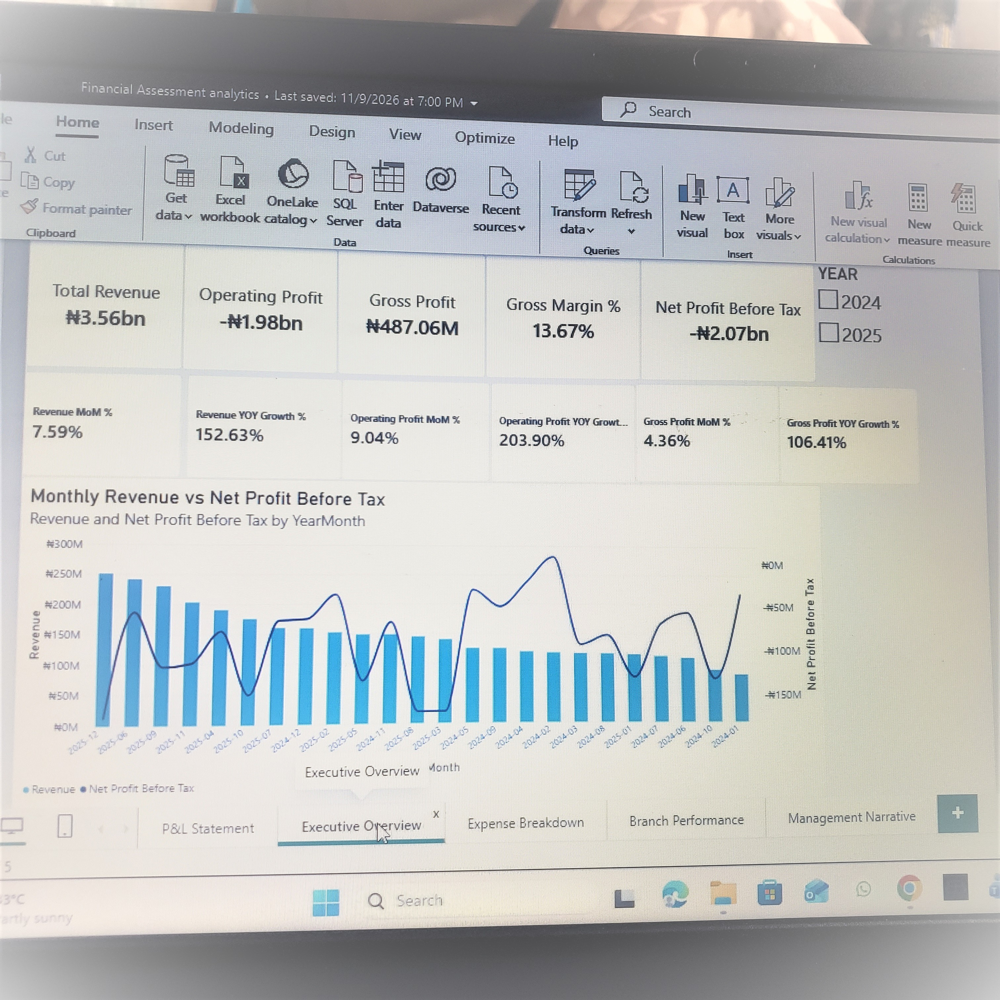
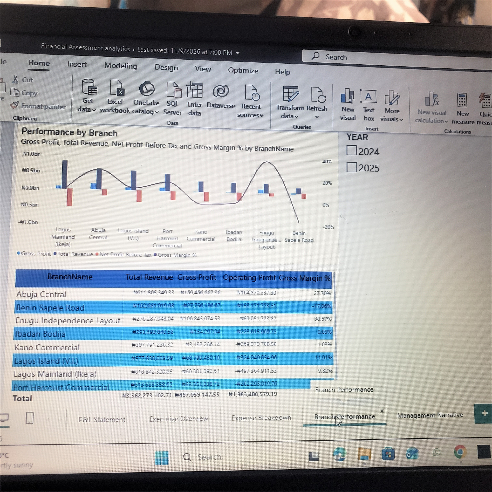
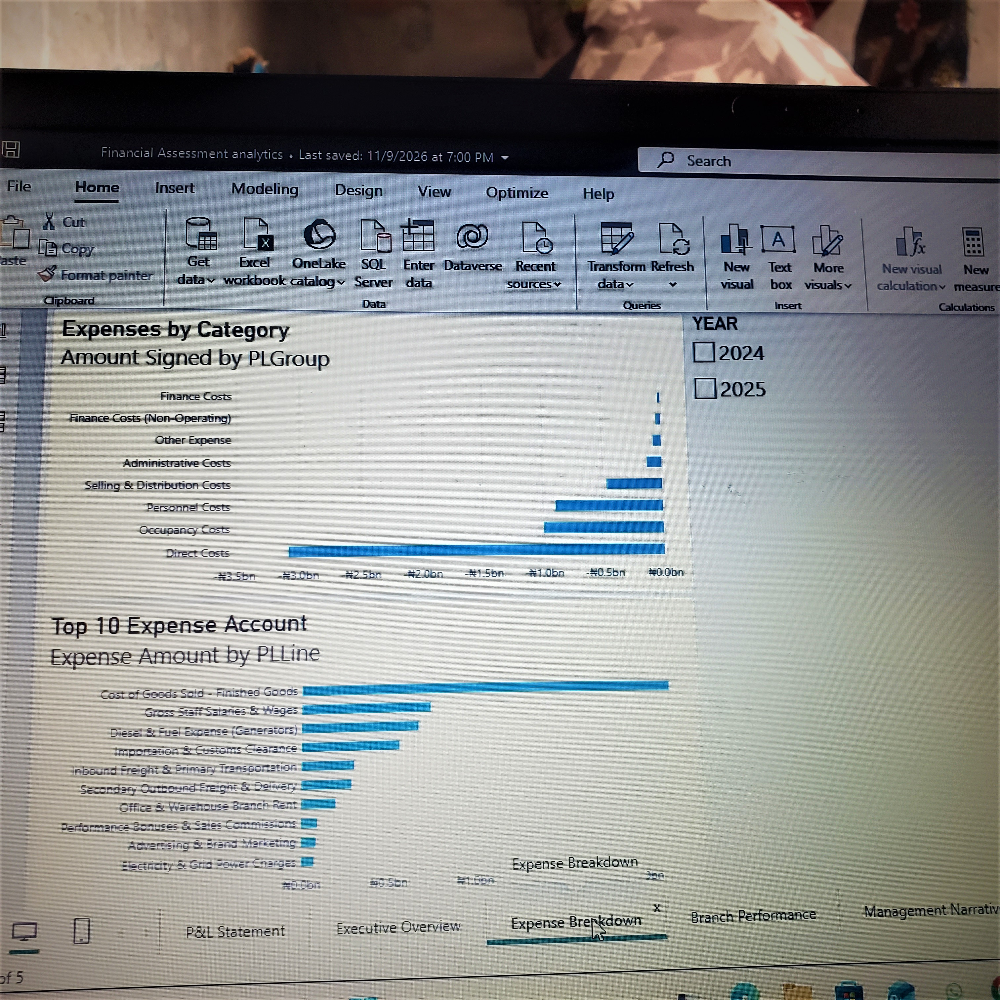
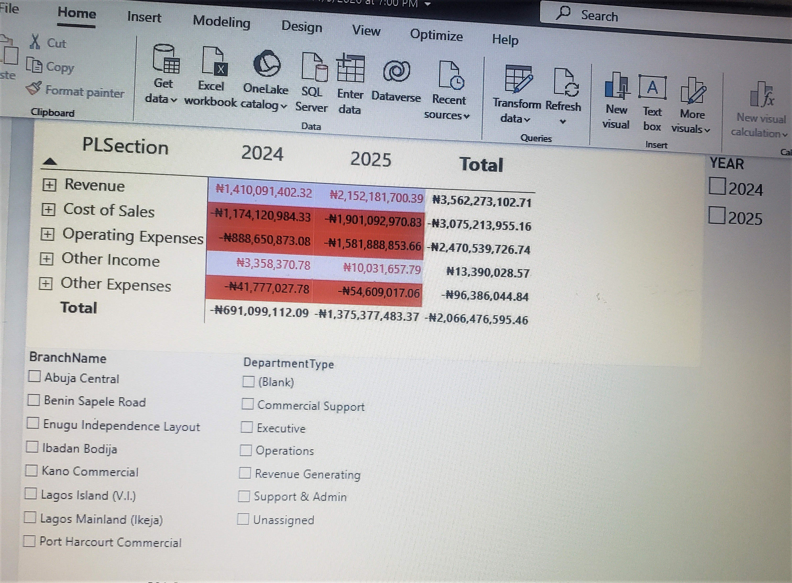
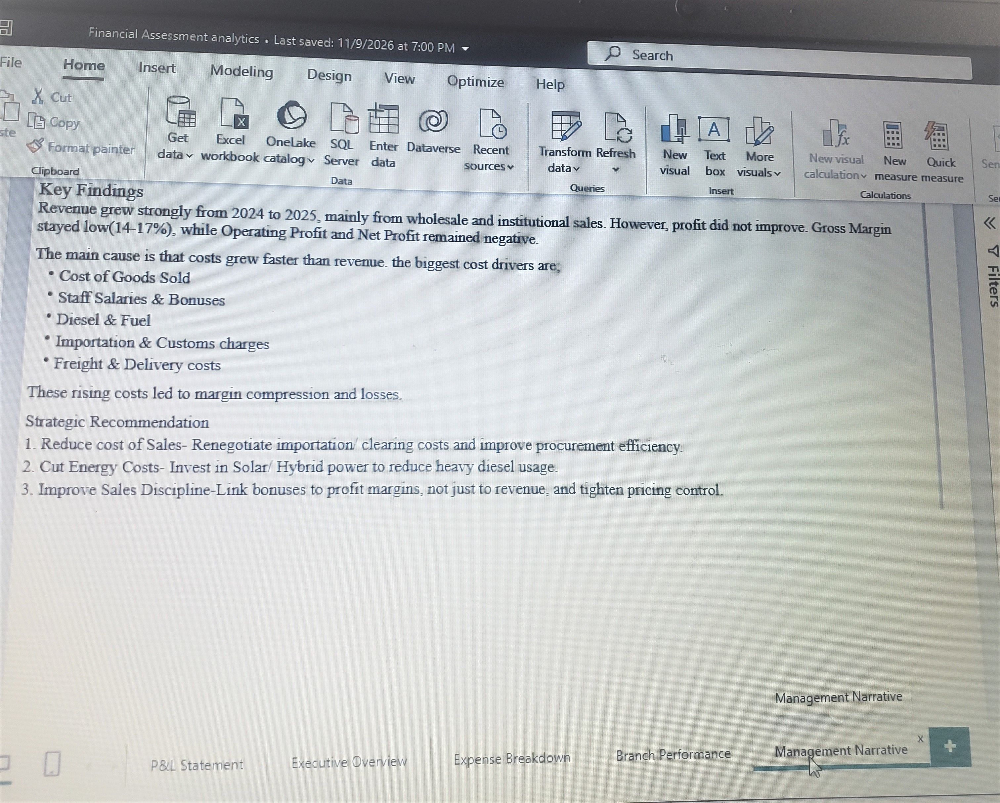

#  Financial Analysis Dashboard – Power BI

**End-to-end financial analysis dashboard** built with Power BI (Incubator Hub Project).

---

## 📌 Project Overview

This project analyzes the financial performance of a mid-sized Nigerian FMCG distribution company.  

Despite strong revenue growth between 2024 and 2025, profit margins were compressing and net profit was not increasing at the same rate. The goal of this dashboard was to uncover the reasons behind this and provide clear, data-driven recommendations to management.

---

## 🎯 Business Questions Answered

- Why is revenue growing but profit not increasing at the same rate?
- Which branches and departments are most efficient?
- What are the major expense drivers affecting profitability?
- How does performance compare year-over-year and month-over-month?

---

## 🛠️ Tools & Skills Used

- **Power BI Desktop**
- **Power Query** (Data cleaning & transformation)
- **DAX** (Measures, Time Intelligence, Calculated Columns)
- **Star Schema** data modelling
- **Excel** (Source data)

---

## 📊 Dashboard Pages

1. **Executive Overview** – High-level KPIs and performance summary  
2. **Branch Performance** – Comparison of performance across branches  
3. **Expense Breakdown** – Detailed analysis of cost drivers  
4. **Profit & Loss Statement** – Interactive financial statement  
5. **Key Findings & Recommendations** – Insights and strategic suggestions

---

## 🔍 Key Insights Delivered

- Identified major expense categories causing margin compression
- Highlighted branch-level and department-level performance differences
- Provided clear YoY and MoM trends
- Delivered actionable recommendations for cost control and profitability improvement

---

## 📷 Dashboard Screenshots

### 1. Executive Overview

### 2. Branch Performance

### 3. Expense Breakdown

### 4. Profit & Loss Statement

### 5. Key Findings & Recommendations

---

## 👩‍💻 Author

**Esther Titilayo Oladunjoye**  
Biochemistry Graduate | Aspiring Data Analyst  

- GitHub: [OladunjoyeEsther](https://github.com/OladunjoyeEsther)  
- LinkedIn: [esther-oladunjoye](https://www.linkedin.com/in/esther-oladunjoye-82470024a)  
- Email: oladunjoyeesther21@gmail.com
